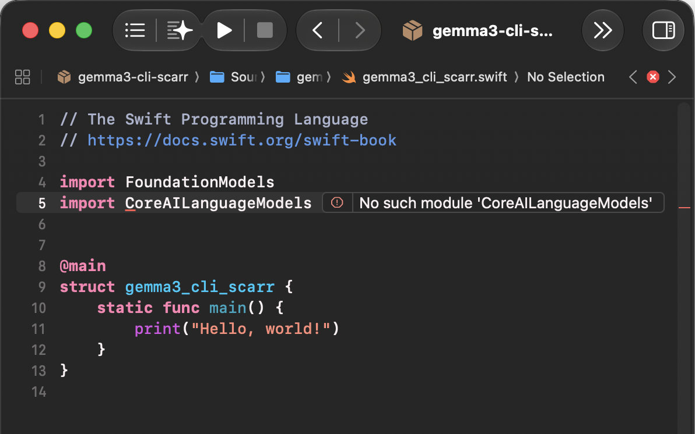

Prompt: 
"Say Hello to the world."

Running in XCode:


Response:
"Hello world! 😊 
It’s nice to be here and connect with you. How’s your day going?"

## Why
Born out of the desire to know where the prompts and other information being used by an LLM to process my requests are stored and used, I wanted to set up a local LLM runner to process prompts and verify that there is no packet of information being sent in or out of the machine its running on, while it is running.

## The process
I first decided to check out [ollama](https://docs.ollama.com/quickstart), but found that after testing a few prompts it still exchanged data over the internet to process my test prompts.

Then after skimming Apples [developer documentation](https://developer.apple.com/machine-learning/), I decided to try Apple Core AI.
This would require familiarity with the Swift programming language because [Core AI](https://developer.apple.com/core-ai/) is a Swift API and the [recipe](https://github.com/apple/coreai-models/tree/main/models/gemma3#run-a-core-ai-language-model) to export and use gemma-3-4b-it (googles open-weight gemma 3 model) with Core AI was in Swift.


*This was reinforced by the problems that arose when first trying to emulate the recipe*

After revieweing [the basics of swift](https://docs.swift.org/swift-book/documentation/the-swift-programming-language/guidedtour/) 
and learning how to use [swift package manager](https://docs.swift.org/swiftpm/documentation/packagemanagerdocs/gettingstarted/) 
to [resolve dependencies](https://docs.swift.org/swiftpm/documentation/packagemanagerdocs/introducingpackages#About-Modules),
I was able to diagnose the cause of the errors to be a misconfigured Swift.package manifest file.

The configuration for the package manifest that worked:
```swift
// swift-tools-version: 6.2
// The swift-tools-version declares the minimum version of Swift required to build this package.

import PackageDescription

let package = Package(
    name: "gemma3-cli-scarr",
    platforms: [
        .macOS("27.0")
    ],
    products: [
        .executable(name: "gemma3-cli", targets: ["gemma3-cli-scarr-target"])
    ],
    dependencies: [
         .package(url: "https://github.com/apple/coreai-models", branch: "main")
    ],
    targets: [
        .executableTarget(
            name: "gemma3-cli-scarr-target",
            dependencies: [
                .product(name: "CoreAILM", package: "coreai-models")
            ],
            path: "Sources",
            swiftSettings: [
                .enableUpcomingFeature("MemberImportVisibility")
            ]
        ),
    ]
)
```
First iterative working version:
```swift
import FoundationModels
import CoreAILanguageModels
import Foundation
import System

@main
struct gemma3_cli_scarr {
    static func main() async {
        let modelURL  = URL(filePath: "/Users/naota/MEDICAL-MECHANICA/the-apple-orchard/coreai-models/exports/gemma_3_4b_it_dynamic")
        do{
            let model = try await CoreAILanguageModel(resourcesAt: modelURL)
            let session = LanguageModelSession(model: model)
            let response = try await session.respond(to: "hello")
            print(response)
        } catch {
            print("error")
        }
    }
}
```
